<p align="center">
  <a href="README.md">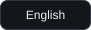</a>
  <a href="README.es.md">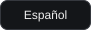</a>
  <a href="README.pt-BR.md">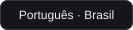</a>
</p>

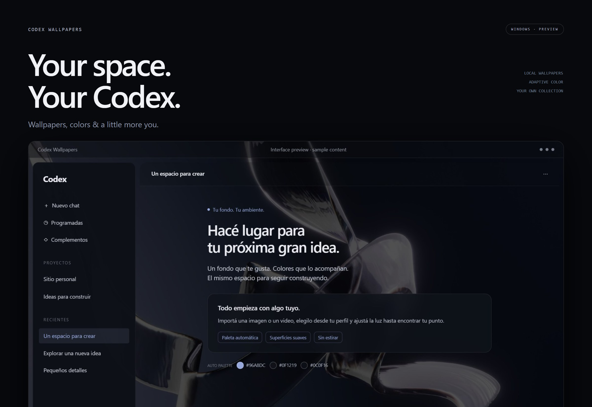

**Make Codex feel like your space.** Pick your own image or video and let the colors follow. Change wallpapers from **Profile → Wallpapers**, then adjust brightness, transparency and rounded corners.

## One interface. A different mood.

These previews use wallpapers from a personal collection with sample content. The accent, sidebar and composer colors are generated from each wallpaper — look at the palette swatches below the message. Click any image for a closer look.

| Glass Ribbons | MacOS Style |
| :---: | :---: |
| [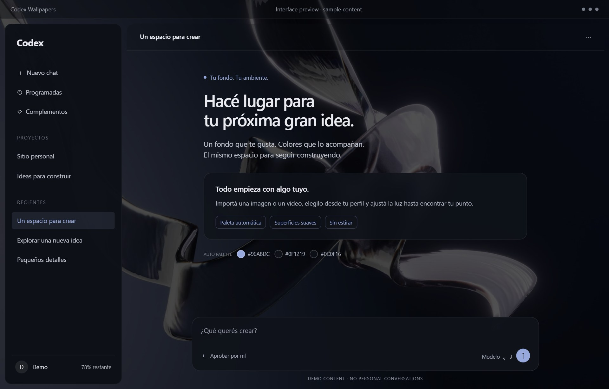](docs/assets/gallery-glass-ribbons.jpg) | [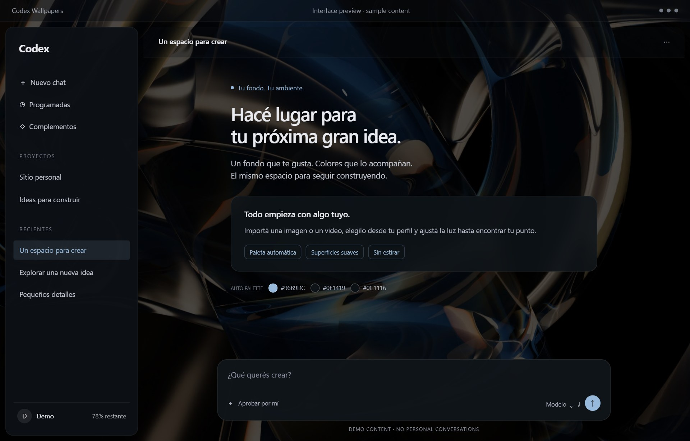](docs/assets/gallery-macos-style.jpg) |
| **MacOs M3** | **Mac Baconai** |
| [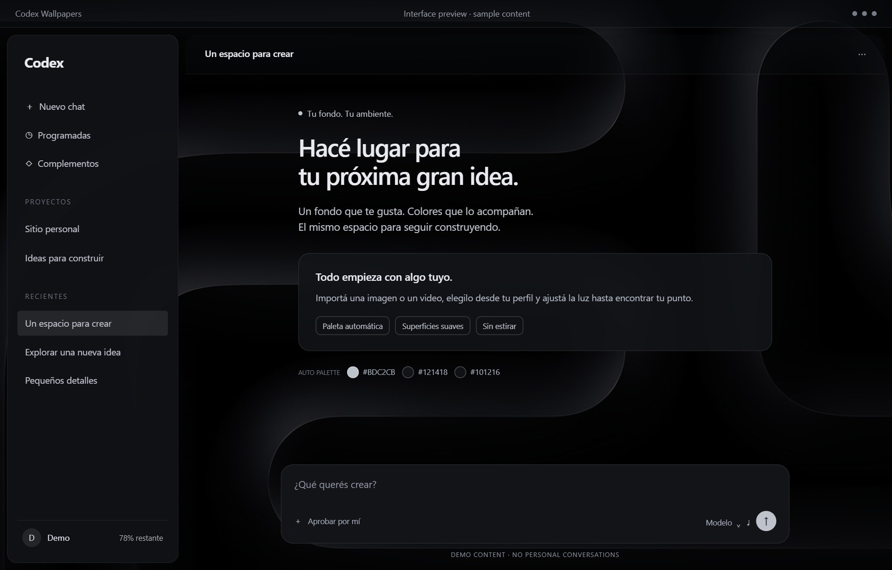](docs/assets/gallery-macos-m3.jpg) | [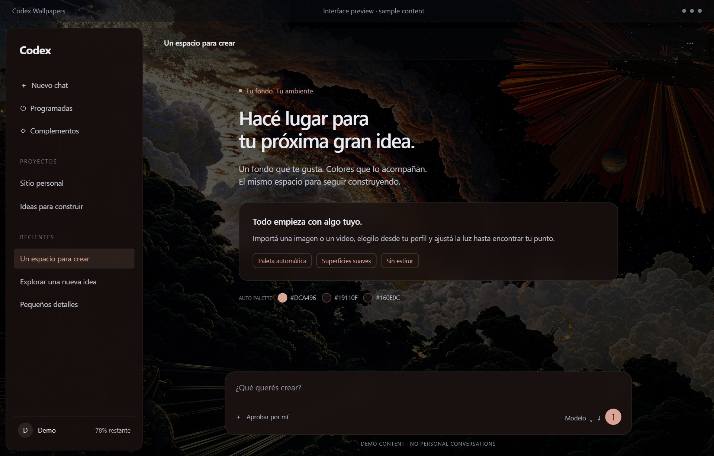](docs/assets/gallery-mac-baconai.jpg) |
| **Red Torii** | **CHR0NIC** |
| [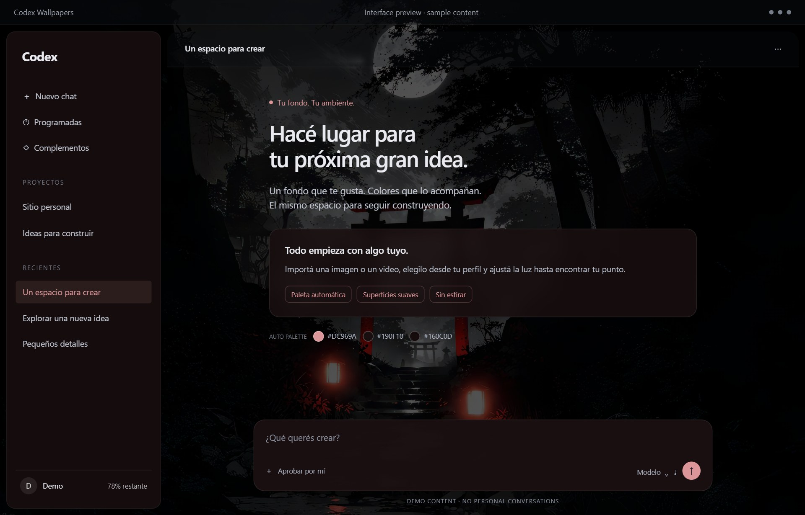](docs/assets/gallery-red-torii.jpg) | [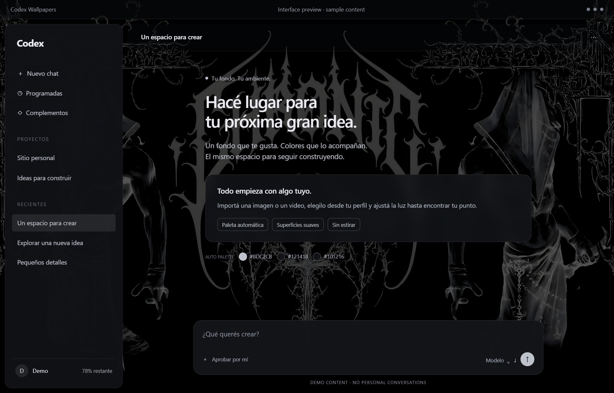](docs/assets/gallery-chronic.jpg) |

The gallery is a showcase, not a bundled collection. [Wallpaper credits](docs/assets/README.md).

## Your collection, one click away

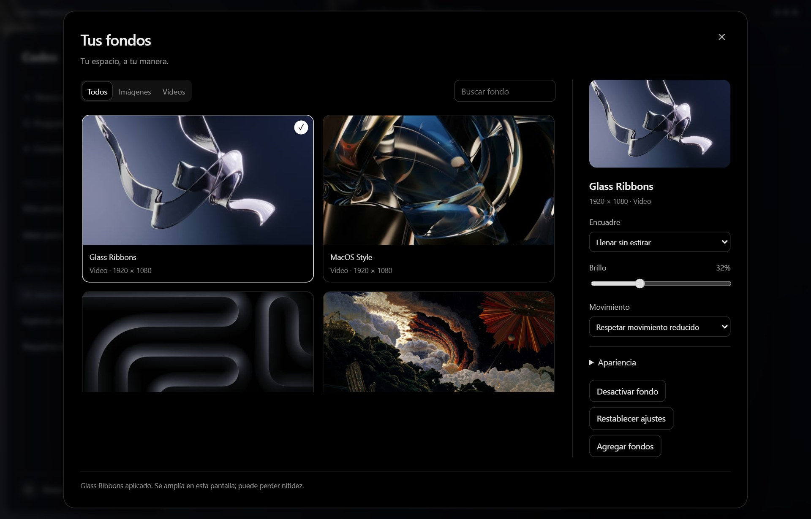

- **Your media:** JPG, PNG, WebP, MP4 and WebM. Videos loop silently.
- **Your colors:** automatic palettes or manual colors, with adjustable opacity and corners.
- **Your layout:** fit without stretching, saved preferences and support for additional windows.
- **Bounded renderer memory:** each window receives the catalog thumbnails and only its currently selected full-size wallpaper. Hidden windows defer animated media.
- **Usage preview:** click the sidebar indicator for official account tokens, peak day, longest task, streaks and daily history. Quota remaining and reset use the native query. Add a private local photo with `+`. [Data sources](docs/USAGE.md).
- **OBS overlay:** animated orb, native quota/reset and a rotating banner that trades places with the usage card. Preview and transparent capture share one renderer and port; messages, social links and priority timing stay in local configuration. [Setup](docs/OBS_USAGE_OVERLAY.md).

## Get started

You need Codex Desktop for Windows, Node.js 22+, and FFmpeg/ffprobe for importing files. Windows launchers also discover the current user’s Codex-bundled Node runtime when Node is absent from Explorer’s PATH. From this repository, run:

```powershell
powershell.exe -NoProfile -ExecutionPolicy Bypass -File .\windows\install.ps1
```

Open **Codex Wallpapers** from Start when you next open Codex. Pin **that shortcut** to the taskbar: it uses the locally installed official icon and launches the same Codex app with personalization. If Codex is already running from its original shortcut, fully quit it first (File → Quit, Ctrl+Q). The original shortcut stays available. [Shortcut details (ES)](docs/WINDOWS.md).

Attach an image or video to your Codex agent and ask:

> Import this wallpaper into codex-wallpapers, preserve the original and check its resolution. Don't restart Codex without asking me.

Then choose it in **Profile → Wallpapers**. The library starts empty. **Wallpaper Engine on Steam** is a suggested source; use a local image or video you have permission to use. Workshop scenes need an image or a recorded/exported video. [Media guide (ES)](docs/MEDIA.md).

## How personalized startup works

**Codex Wallpapers** launches the official Windows app, not a separate Codex build. It inspects the installed interface, opens a loopback-only debugging connection, verifies the official process identity, then loads the wallpaper, picker and usage indicator. A session helper saves preferences and handles new windows. It does not restart Codex to recover from failures.

If Codex is already running from its original shortcut, the personalized launcher only activates that existing instance. Quit normally when convenient, then open **Codex Wallpapers**. Pinning the original app shortcut can launch without personalization; check the pinned shortcut target.

An incompatible interface opens normally. Static inspection cannot generate adaptations for every future release. The native update/restart button has a bounded independent handoff; see [update behavior and verification limits](docs/UPDATES.md).

## Importing and keeping wallpapers

In **Profile → Wallpapers**, set **Shuffle wallpapers → On**, then choose **Change every (minutes)** from 1 to 1440 (default: 5). Shuffle picks from all imported wallpapers without immediately repeating the current one. It waits when fewer than two wallpapers are available. **Off** cancels rotation and keeps the current wallpaper. Hiding the window or disabling wallpapers pauses rotation; returning starts a full interval. The mode and interval persist with your preferences. The personalized session helper must be running to transfer each new media file.

From the repository directory, with Node, FFmpeg and ffprobe available:

```powershell
node .\src\cli.mjs data-dir
node .\src\cli.mjs import "C:\Wallpapers\background.mp4" --title "My wallpaper"
node .\src\cli.mjs list
```

Import copies the media into your library and generates a thumbnail and palette, preserving the original. Choose it in **Profile → Wallpapers** on the next personalized launch. Updating an already open session requires a verified existing connection; see the [agent guide](docs/AGENT.md).

| Content | Default location |
| --- | --- |
| Installed code and launcher | `%LOCALAPPDATA%\CodexWallpapers\app` |
| Library, media and preferences | `%LOCALAPPDATA%\CodexWallpapers` |
| Development checkout | Wherever you cloned this repository |

`CODEX_WALLPAPERS_DATA` overrides the data directory. Import and startup must use the same directory. Selection and appearance settings persist on disk and restore on personalized startup, even without browser storage. Invalid replacement media preserves an already working background. Videos are silent and respect reduced motion.

Back up the data directory, including library, media and preferences. Personal wallpapers and the local profile photo are not uploaded to GitHub. Each new user starts with an empty library and their own account data; showcase images are not included.

## Updates and Windows sign-in

**Updating Codex, pulling this repository and updating the installed copy are separate operations.** `git pull` does not replace `%LOCALAPPDATA%\CodexWallpapers\app`. Back up your data and follow the [preserving-data update procedure](docs/UPDATES.md); the installer refuses to overwrite an existing installation.

Installation creates a Start menu shortcut, **not automatic Windows startup**. To enable sign-in startup, copy the personalized shortcut into the folder opened by `shell:startup` and check that Windows Startup Apps enables it. OBS runs separately on a local port and has its own startup setup: [OBS guide](docs/OBS_USAGE_OVERLAY.md).

| Symptom | Check |
| --- | --- |
| Codex opens without the theme | Shortcut target, an already running normal instance, compatibility logs in the data directory. |
| Wallpaper picker or usage is missing | Installed code version and profile-menu recognition; the new Spanish label is supported. |
| Wallpaper is forgotten | Same data directory for import/startup, write permissions and saved media availability. |
| OBS does not start with Windows | Its Startup Apps entry; explicit `-InstallStartup` re-enables a disabled overlay entry. |

Do not delete preferences or locks blindly. Check process ownership first; see [recovery](docs/UPDATES.md).

## Safety & status

**Independent, experimental project.** It applies CSS/JavaScript through local Electron debugging. It is not an official plugin or approved by OpenAI; compatibility and freedom from account restrictions are not guaranteed. [Security & scope](docs/SECURITY.en.md).

**Preview:** isolated transfer, UI and Windows shortcut checks pass. The full media library is no longer copied into every renderer. A clean-install startup still needs manual validation. If personalization fails, Codex stays open; the project never restarts it to recover.

[Agent guide (ES)](docs/AGENT.md) · [Updates (ES)](docs/UPDATES.md) · [Tests (ES)](docs/TESTING.md) · [MIT license for code](LICENSE)
